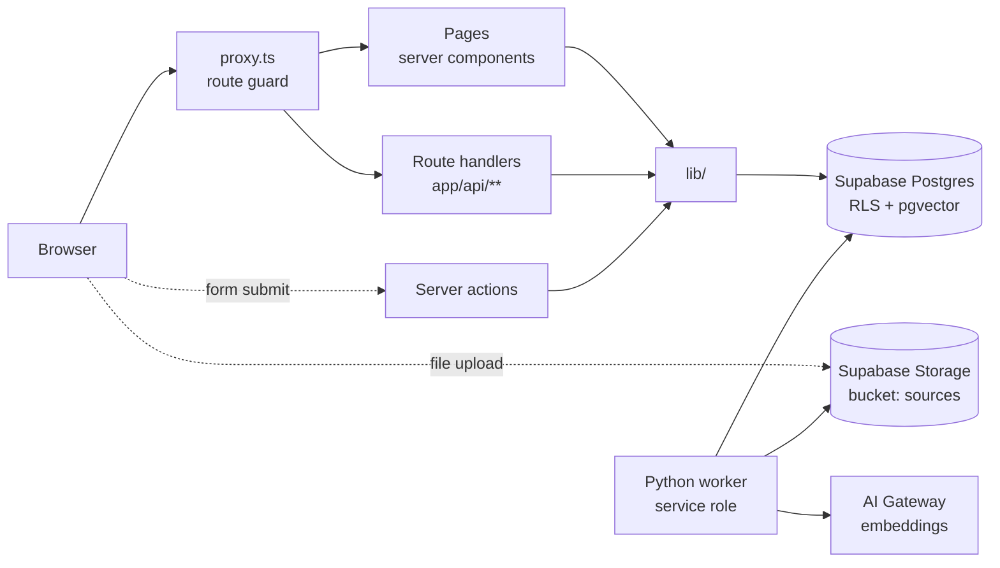
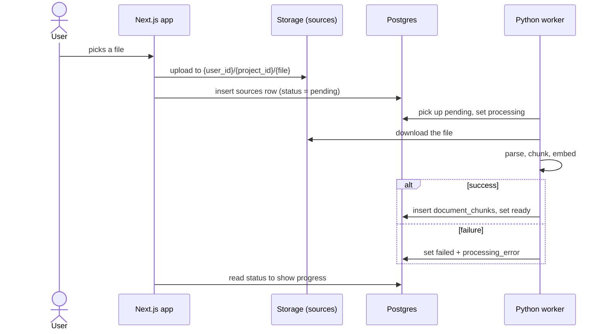
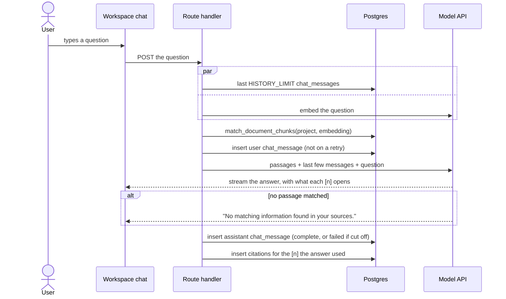

# Architecture

How the app is actually built: which piece handles which job, and how a request moves
through it. For the tables themselves, see [data-model.md](data-model.md).

## No controller layer

The original spec modelled the system as entity, boundary, and controller objects
(`AuthController`, `ProjectController`, …). **We don't build those classes.** In a
Next.js + Supabase app, their jobs are already split between the framework, Supabase,
and a few thin files:

| Spec idea  | What does that job here                                                                                                        |
| ---------- | ------------------------------------------------------------------------------------------------------------------------------ |
| Boundary   | A route (`app/**/page.tsx`) and its components (`components/`)                                                                 |
| Controller | A **route handler** (`app/api/**/route.ts`) or **server action** (`actions.ts`): check sign-in, validate with zod, call `lib/` |
| Logic      | A plain function in `lib/` (e.g. `lib/projects.ts`) that takes a Supabase client                                               |
| Security   | **Row-level security** in Postgres, plus the route guard in `proxy.ts`                                                         |
| Identity   | **Supabase Auth** — users, sessions, tokens, emails                                                                            |
| Entity     | A Postgres table in `supabase/migrations/`, typed by `lib/supabase/database.types.ts`                                          |

Where each kind of file goes: [01-project-structure](../rules/01-project-structure.md).

## The pieces

| Piece          | Where                                                  | Does                                                                                                                                                                                                 |
| -------------- | ------------------------------------------------------ | ---------------------------------------------------------------------------------------------------------------------------------------------------------------------------------------------------- |
| Route guard    | `proxy.ts` → `lib/supabase/proxy.ts`                   | Refreshes the session cookie. Signed out: pages redirect to `/login`, `/api/*` answers 401. Public paths are listed there                                                                            |
| Pages          | `app/**/page.tsx`                                      | Server components. Read data on the server through `lib/`                                                                                                                                            |
| Route handlers | `app/api/**/route.ts`                                  | The REST API. Check sign-in → zod → `lib/` → `Response.json`                                                                                                                                         |
| Server actions | `app/**/actions.ts`                                    | The app's own forms (sign-in, create project, remove source). Same three steps as a route handler                                                                                                    |
| `lib/`         | `lib/projects.ts`, `lib/sources.ts`, `lib/supabase/*`  | Queries. Maps snake_case rows to camelCase domain types. Returns `{ ok, … }` results, never throws for expected failures                                                                             |
| Supabase Auth  | hosted                                                 | Sign-in codes, sessions (a cookie pair), JWTs, the `auth.users` table                                                                                                                                |
| Postgres + RLS | `supabase/migrations/`                                 | All data. RLS limits every query to the signed-in user's projects. Deletes cascade                                                                                                                   |
| pgvector       | `document_chunks.embedding`, `match_document_chunks()` | Semantic search, filtered to one project; `match_source_chunks()` takes the best few from each chosen source (Compare); `sample_source_chunks()` spreads a sample through each ready source (Themes) |
| Storage        | bucket `sources`                                       | Uploaded files at `{user_id}/{project_id}/{file}`. Storage policies allow only your own folder                                                                                                       |
| Worker         | `worker/` — separate Python service, on Railway        | Claims pending sources; parses, chunks, and embeds them; moves their status. Service role, so it bypasses RLS                                                                                        |

### Two rules every backend change follows

1. **Run queries as the user.** Use `createClient()` from `lib/supabase/server.ts`, never
   the service role, so RLS applies. Another user's row then reads as "not found" — no
   ownership check needed in code
2. **Check sign-in and validate, even behind the guard.** The proxy already blocks
   signed-out requests, but each route handler and server action calls
   `getSupabaseUser()` and re-validates input with zod. Server actions are public
   endpoints

## Who handles each job

What became of every controller in the spec. **Dropped** means there is nothing to
build — something else already does it.

### Identity and security — handled by Supabase and Postgres

| Spec controller    | Now                                                                                                                                                                                                                                                                                                                                      | Status |
| ------------------ | ---------------------------------------------------------------------------------------------------------------------------------------------------------------------------------------------------------------------------------------------------------------------------------------------------------------------------------------- | ------ |
| AuthController     | **Dropped.** Supabase Auth: `signInWithOtp` / `verifyOtp` / `signOut` in `app/login/actions.ts`. Sessions and JWTs are Supabase's; read with `getClaims()`                                                                                                                                                                               | Built  |
| OAuthController    | **Dropped.** Supabase's Google provider: `signInWithOAuth` (`signInWithGoogle` in `app/login/actions.ts`), plus one callback route that calls `exchangeCodeForSession` (`app/auth/callback/route.ts`)                                                                                                                                    | Built  |
| UserController     | **Mostly dropped.** Email change is Supabase's `updateUser`, which emails a code to the new address; `verifyOtp` with that code switches it (`lib/account.ts`). Account deletion needs one server-side call with the service role (`auth.admin.deleteUser`); the database cascades the rest. Storage is cleared first (`lib/account.ts`) | Built  |
| SecurityController | **Dropped.** RLS on every table and the storage bucket, `proxy.ts` for routes, zod for input, Next.js origin check on server actions                                                                                                                                                                                                     | Built  |

### Projects and sources — thin routes over `lib/`

| Spec controller         | Now                                                                                                                                                                                                                                                                                                                  | Status       |
| ----------------------- | -------------------------------------------------------------------------------------------------------------------------------------------------------------------------------------------------------------------------------------------------------------------------------------------------------------------- | ------------ |
| ProjectController       | `lib/projects.ts`, exposed by `app/api/projects/**` and the `createProject` server action                                                                                                                                                                                                                            | Built        |
| SourceController        | `lib/sources.ts` with authenticated GET/POST and PATCH/DELETE source routes. User edits can change only the title; delete removes the Storage file after the row                                                                                                                                                     | Built        |
| UploadController        | **Mostly dropped.** The bucket enforces type (PDF, text, Markdown) and size (50 MiB). The app uploads to Storage, then inserts the `sources` row                                                                                                                                                                     | Built        |
| LinkIngestionController | Link sources. **Web links:** the Add link form (`addLinkSource` action) inserts a `link` row; the worker fetches the page, extracts its text, and chunks and embeds it (CECS491-85). Chat, Compare, and Themes search links like files; a link's citation shows the passage and opens the page. YouTube is not built | Partly built |

### Processing — the worker

| Spec controller         | Now                                                                                        | Status |
| ----------------------- | ------------------------------------------------------------------------------------------ | ------ |
| ProcessingJobController | **Dropped.** `sources.status` is the queue: `pending → processing → ready \| failed`       | Built  |
| ParsingController       | Worker step. Writes extracted details to `sources.metadata`                                | Built  |
| ChunkingController      | Worker step. Writes `document_chunks` with `chunk_index` and `page_number`                 | Built  |
| IndexingController      | **Mostly dropped.** Worker writes the embedding; the HNSW index in Postgres updates itself | Built  |

### AI — route handler + `lib/`

| Spec controller        | Now                                                                                                                                                                                                                                               | Status       |
| ---------------------- | ------------------------------------------------------------------------------------------------------------------------------------------------------------------------------------------------------------------------------------------------- | ------------ |
| RetrievalController    | **Mostly dropped.** `match_document_chunks(project_id, query_embedding)` in Postgres. Runs as the user, so RLS applies. Searches `ready` sources only. Chat calls it through `findChatPassages` in `lib/answer.ts`                                | Built        |
| AIController           | `lib/ai.ts`: closed-context prompt, question embedding, and the one streaming model call (AI Gateway). Swap it there                                                                                                                              | Built        |
| ChatController         | `POST /api/projects/[projectId]/chat`: retrieves passages, streams the answer (AI SDK UI message stream), and writes `chat_messages`                                                                                                              | Built        |
| CitationController     | `createCitations` in `lib/chat.ts`: a `citations` row per passage the answer cites, with its number. RLS rejects a chunk from another user's project                                                                                              | Built        |
| Comparison             | `POST /api/projects/[projectId]/compare`: embeds the topic, `match_source_chunks` per chosen source (`lib/comparison.ts`), streams `streamComparison` from `lib/ai.ts` with passage citations. Not saved                                          | Built        |
| Insight (themes)       | `POST /api/projects/[projectId]/themes`: `sample_source_chunks` takes passages spread through every ready source (`lib/themes.ts`), streams `streamThemes` from `lib/ai.ts` with passage citations. 2–15 ready sources, else 409 / 422. Not saved | Built        |
| Summary                | Same pattern as chat                                                                                                                                                                                                                              | Stretch goal |
| NotificationController | **Dropped.** No use case needs it. Processing progress shows through `sources.status`                                                                                                                                                             | —            |

## Screens and routes

| Screen                | Route                                                      | Use cases     | Status      |
| --------------------- | ---------------------------------------------------------- | ------------- | ----------- |
| Landing page          | `/home` (`/` redirects by sign-in state)                   | —             | Built       |
| Sign in (and sign up) | `/login` — Google button, or email then 6-digit code       | UC-01, UC-03  | Built       |
| Dashboard             | `/dashboard`                                               | UC-09         | Built       |
| New project           | `/projects/new`                                            | UC-07         | Built       |
| Workspace             | `/projects/[projectId]` — sources + chat                   | UC-09, UC-16  | Built       |
| Sources               | `/projects/[projectId]/sources`                            | UC-11 – UC-14 | Built       |
| Summaries             | `/projects/[projectId]/summaries`                          | UC-17         | Placeholder |
| Analysis              | `/projects/[projectId]/analysis` — Compare and Themes tabs | UC-18, UC-19  | Built       |
| Settings              | `/settings` — change email, sign out, delete account       | UC-04 – UC-06 | Built       |
| Edit project          | `/projects/[projectId]/edit`                               | UC-08         | Built       |
| Citation viewer       | A sheet over any project screen, opened by a `[n]` chip    | UC-20         | Built       |

## How a source gets processed (UC-11, UC-15)

### How the worker finds new rows

It polls. Every few seconds `worker/` calls `claim_pending_sources()`, which takes the
oldest `pending` rows `FOR UPDATE SKIP LOCKED` and sets them `processing` in one
statement, so two workers never get the same source. Each worker runs up to
`WORKER_CONCURRENCY` sources at once; more throughput is more worker processes. A source
left in `processing` by a crashed worker is failed by `fail_stale_sources()`. Why polling
and not a database webhook: [ADR 0001](../adr/0001-worker-polls-for-pending-sources.md).

### How the user sees progress

The app polls too: while any source is `pending` or `processing`, the Sources page and
the workspace's Sources panel call `router.refresh()` every 3 s
(`sources/refresh-while-processing.tsx`). A `failed` source shows its `processing_error`
and a **Retry processing** button, which calls `retry_failed_source()` to set it back to
`pending`. A `ready` source has **Process again**, which calls `reprocess_ready_source()`
to do the same: the worker replaces its chunks and metadata (a link is fetched again),
and earlier answers lose their citation links into it. Until a source is `ready`, the workspace says so (UC-16 E2); chat refuses
until one is, since only `ready` sources have chunks to search.

## How a question gets answered (UC-16)

Chat retrieves (CECS491-73). `POST /api/projects/[projectId]/chat` embeds the question
(`embedQuestion`, the worker's model), and `findChatPassages` in `lib/answer.ts` calls
`match_document_chunks` for the 8 closest chunks across the project's `ready` sources.
A question that names a source by its title, the title inside the document, or a link's host ("summarize workos.com",
`findNamedSources`) is answered from the named sources only: up to 16 passages shared
between them, half spread through each source and half its closest chunks
(`match_source_chunks`). A chunk's text doesn't carry its source's name, so the
project-wide search alone can't find a source by name.
Every prompt also opens with the project's source list (`toListedSources`): each chat
source's title, kind, link, and what the worker put in `metadata` (page count, the
document's own title, author, subject, and the short `summary` it writes after
embedding, `worker/src/worker/summary.py`). The model uses it to tell which source a
question means and to say what the project holds; it still cites passages only.
`streamGroundedAnswer` in `lib/ai.ts` sends those chunks numbered `[1]…[n]` plus the last
`HISTORY_LIMIT` turns. The numbers restart with every answer, so each saved answer keeps
its own `citations` rows: one per passage it cites, with the `number` it used. A citation
opens the citation viewer (CECS491-78): it downloads the file from `GET …/sources/[sourceId]/file`,
shows the cited page of a PDF (react-pdf), and marks the cited chunk's text on it. A text file
is shown whole with the passage marked. If the passage can't be found, the page still opens.
A web link has no stored file, so its citation shows the cited passage and opens the page
itself (the citation carries the source's `url`).

Answers saved before retrieval cited whole sources and have no `citations` rows, so
their `[n]` no longer link.

Retrieval sends the model the matching chunks and the last few messages — never the
whole chat history.
